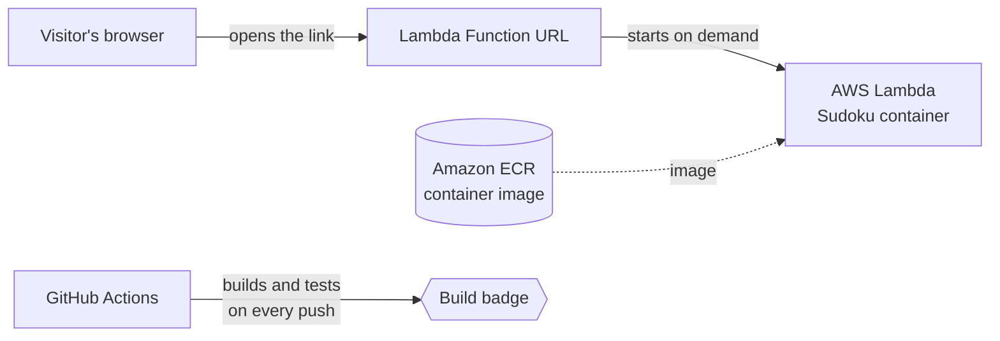

# Sudoku on AWS Lambda


A Sudoku web game packaged in a Docker container and deployed to AWS Lambda.
It only runs when someone plays, so it costs almost nothing to keep online.

**▶ Play it:** https://n7z2ssrtcodo4gecmd6lmviwka0sxvew.lambda-url.us-east-1.on.aws/
(The first visit after a quiet spell takes a few seconds while the container starts.)

## How it works



- **Flask + gunicorn** serve the game; the puzzle checking runs in the browser.
- **AWS Lambda Web Adapter** lets the same container run on Lambda and with plain `docker run`.
- **GitHub Actions** builds the image and checks the app answers on every push.

## Run it yourself

```bash
docker build -t sudoku .
docker run -p 8090:8080 sudoku
```

Then open http://localhost:8090

## Cost and safety caps

- Scales to zero: no visitors, no running containers.
- A 10-second timeout per request and 512 MB of memory per copy.
- A $5 monthly AWS budget alert.

## What I learned

- **Pushing images to Amazon ECR.** A full image name tells Docker where to push it:
  `<account-id>.dkr.ecr.<region>.amazonaws.com/<repository>:<tag>`. Publishing is three
  moves: log in to the registry, `docker tag` the image with that full name and a version
  (`1.0`, not just `latest`), then `docker push`.
- **CI with GitHub Actions.** GitHub only runs automation that is defined in a workflow file
  (`.github/workflows/build.yml`). Mine builds the image and checks that the app answers on
  every push, so the badge only turns green when the game actually works.
- **Doing it all from the command line.** I built, tagged and pushed the image with the
  Docker CLI, created the ECR repository, IAM role and Lambda function with the AWS CLI,
  and created and pushed this repository with Git and the GitHub CLI. 
- **Containers on Lambda.** Lambda does not run as root, so the app listens on port 8080
  instead of 80, and the AWS Lambda Web Adapter lets the same image run on Lambda and with
  plain `docker run`.
- **IAM: users vs roles, and least privilege.** I stopped using the root account and
  deployed as an IAM user, while the Lambda function runs as its own IAM role
  (`sudoku-lambda-role`) that is only allowed to write logs. People sign in as users;
  AWS services act through roles, with only the permissions they need.
- **Cost and limits.** Lambda scales to zero, so the demo costs almost nothing when nobody
  is playing. I set a timeout and a budget alert, and learned that new AWS accounts start
  with a low concurrency limit that has to be raised before a function can reserve its own.


## Credits

The Sudoku app comes from the 2026 Containerization with Docker DevOps Master course; the Dockerfile,
Lambda deployment, pipeline and documentation are my own work.
